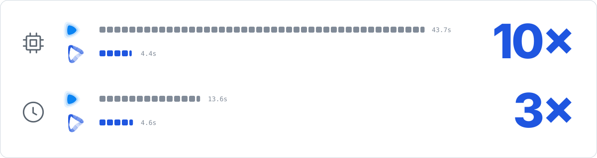

<a href="https://konecz.com">
<picture>
  <source media="(prefers-color-scheme: dark)" srcset="https://raw.githubusercontent.com/konecz/kodecz/main/marca/cabecalho-escuro.svg">
  
</picture>
</a>

**Kodecz is an open-source video rendering engine that turns a web page into an MP4.** You write the video in HTML,
CSS and JavaScript (React, WebGL, GSAP, Lottie or nothing at all), and Kodecz renders it frame by frame on an NVIDIA
GPU with NVENC or on any CPU with x264, without taking a screenshot of every frame. It is an alternative to Remotion
and HyperFrames, made to be driven by AI agents.

<p align="center">
  <a href="#quick-start">Quick start</a> ·
  <a href="#write-a-video">Write a video</a> ·
  <a href="#how-it-works">How it works</a> ·
  <a href="#numbers">Numbers</a> ·
  <a href="#for-ai-agents">For AI agents</a> ·
  <a href="#faq">FAQ</a> ·
  <a href="LEIAME.md">Português</a>
</p>

If Chromium can draw it, Kodecz can render it:

<picture>
  <source media="(prefers-color-scheme: dark)" srcset="https://raw.githubusercontent.com/konecz/kodecz/main/marca/tecnologias-escuro.svg">
  
</picture>

<a id="how-it-works"></a>

## How it works

Two paths, one folder. Other tools take a screenshot of every frame and turn it into a PNG before encoding it;
Kodecz never does, with or without a GPU.

<picture>
  <source media="(prefers-color-scheme: dark)" srcset="https://raw.githubusercontent.com/konecz/kodecz/main/marca/caminho-escuro.svg">
  
</picture>

**Page** is your `index.html`. **Chromium** draws frame *N*. On a GPU, that frame stays on the card as a
**texture**; on the CPU, it is the **raw frame** Chromium just painted. Either way it goes straight to the encoder,
**NVENC** on the card or **x264** on the processor, and comes out as an **MP4** with the audio mixed in. Frame *N* is
always the same pixels, in order, out of order or starting from the middle.

<a id="numbers"></a>

## Numbers

<picture>
  <source media="(prefers-color-scheme: dark)" srcset="https://raw.githubusercontent.com/konecz/kodecz/main/marca/numeros-escuro.svg">
  
</picture>

Each square is one second. Rendering the same video, Kodecz keeps the processor busy for **10× less time**
(43.7 s → 4.4 s of CPU) and hands you the MP4 **3× sooner** (13.6 s → 4.6 s on the clock).

<sub>1080p · 150 frames · H.264 · RTX 5090 · <a href="docs/medidas.md">how we measured</a></sub>

## Kodecz, Remotion and HyperFrames

| | Kodecz | Remotion | HyperFrames |
|---|---|---|---|
| You write the video in | any web page: HTML, CSS, JS, React, WebGL | React components | HTML |
| How each frame leaves the browser | GPU texture or the raw painted frame, no screenshot | screenshot (`Page.captureScreenshot`) | screenshot (`HeadlessExperimental.beginFrame`) |
| Encoding | NVENC on the GPU, or x264 on the CPU | ffmpeg, x264 on the CPU by default | ffmpeg |
| CPU time for the same 1080p video | **4.4 s** | 43.7 s | not measured yet |
| License | Apache-2.0 | Remotion License (paid for companies above 3 people) | Apache-2.0 |

<sub>Remotion and HyperFrames are good tools, and Kodecz learned from both. The capture methods come from their source
code; the CPU numbers are ours, in <a href="docs/medidas.md">docs/medidas.md</a>.</sub>

## Quick start

> **Status:** private preview. The engine is being moved here from our internal repository; the commands below are
> the ones it ships with.

Requirements: Linux, Node 24 and `ffmpeg`. For the GPU path, an NVIDIA GPU with NVENC (tested on an RTX 5090,
driver 570+) and Rust (stable). Without one, the installer sets up the CPU path and everything else works the same.

```bash
git clone https://github.com/konecz/kodecz && cd kodecz
./install.sh                              # checks the system and renders a test video
kodecz render my-video/ MyVideo out.mp4    # GPU when there is one, CPU when not
```

| Option | What it does |
|---|---|
| `--hevc` | HEVC instead of H.264 |
| `--alpha` | transparent video (HEVC with alpha) |
| `--from N` | start at frame *N* (same pixels as a full render) |
| `--cpu` | render on the CPU even when there is a GPU |
| `kodecz preview my-video/ MyVideo --frame 90` | one frame as PNG, in about a second |
| `kodecz preview my-video/ MyVideo --watch` | re-renders the frames you are looking at on every save |

## Write a video

A video is a folder. `index.html` declares the size, frame rate and length; everything else is a normal web page.

```html
<script type="application/json" id="kodecz">
{ "id": "MyVideo", "width": 1920, "height": 1080, "fps": 30, "frames": 150 }
</script>

<style>
  :root { --fps: 30 }
  h1 {
    font: 800 120px/1 "Schibsted Grotesk", sans-serif;
    animation: in 0.6s cubic-bezier(.3, 0, .2, 1) both;
    animation-delay: calc(15 * 1s / var(--fps));   /* enters on frame 15 */
  }
  @keyframes in { from { opacity: 0; transform: translateY(40px) } }
</style>

<h1>Hello, frame 15.</h1>
<video src="presenter.mp4" data-start="0" data-frames="150"></video>
<audio src="music.wav" data-start="30" data-volume="0.6"></audio>
```

- **Animation:** CSS `@keyframes`, `element.animate()`, GSAP and Lottie (bring your own copy). Kodecz pauses the
  page's timeline and puts every animation at `N / fps` before drawing frame *N*.
- **Canvas and WebGL:** export `window.kodecz_frame(n, ms)`; it runs before each frame.
- **Video and audio:** `<video>` and `<audio>` are decoded on the GPU (NVDEC) and mixed in a single pass; the
  presenter video is composited under the page on the GPU, never inside the browser.
- **Not allowed:** `requestAnimationFrame`, timers and the wall clock. They do not follow frame *N*, and Kodecz
  tells you which ones it found.

## For AI agents

<picture>
  <source media="(prefers-color-scheme: dark)" srcset="https://raw.githubusercontent.com/konecz/kodecz/main/marca/agentes-escuro.svg">
  
</picture>

Kodecz is made for any agent to write video with: a coding agent in a terminal, an agent in your own pipeline, or a
script calling a model. Nothing in it is tied to one vendor. The agent needs only what it already handles: files,
shell commands, HTML and CSS, and JSON.

- **The format is plain web.** A video is an `index.html` and its files. Any model that writes web pages can write a
  video, and any tool that edits files can change one.
- **Kodecz blocks** (`blocos/`): each editing technique (one-line captions, zoom to the end of a sentence, text that
  avoids the face...) is a folder with a `KODECZ.md` in plain Markdown (what, when, parameters, where it came from),
  the CSS, a snippet to paste and a right and a wrong example. An index lists them all, so an agent can find the
  right one without reading everything.
- **Automatic checks:** `kodecz check` looks at the frames themselves (text inside the safe area, text over a face,
  contrast, captions too long) and answers with one JSON line plus a picture of each problem, so the agent can fix
  it before a human looks.
- **Previews in about a second**, so the agent sees what it wrote instead of guessing.

<a id="faq"></a>

## FAQ

### Does Kodecz work without a GPU?

Yes. Without an NVIDIA GPU, Kodecz renders on the CPU: Chromium paints in software and the raw frame goes straight to
x264. The same folder renders on both, frame for frame.

### Is Kodecz an alternative to Remotion?

Yes. Both turn code into video. Remotion asks you to write React components; Kodecz takes any web page. On the same
1080p video with a presenter, Kodecz used 10 times less CPU and finished 3 times sooner on the GPU path.

### Which AI agents can use Kodecz?

Any agent that can write files and run commands: Claude Code, Codex, Cursor, Gemini CLI or your own. The format is
plain HTML, the editing blocks are Markdown and the checks answer in JSON. See [`AGENTS.md`](AGENTS.md).

### Is the output deterministic?

Yes. Frame *N* depends only on the page and on *N*: rendering in order, out of order or from the middle gives the same
pixels. Timers and the wall clock are not allowed in a composition, and Kodecz tells you if it finds one.

### Which formats does it export?

MP4 with H.264 (default) or HEVC, transparent video (HEVC with alpha), and AAC audio mixed from every `<audio>` and
`<video>` on the page.

## Patents

Kodecz contains no video codec. It asks the NVENC encoder in your GPU (or the `ffmpeg` installed on your system) to
encode H.264 or HEVC. Those formats are covered by patent pools; using them in a product you sell or distribute may
need a license from those pools, as with any software that writes H.264 or HEVC. See [`docs/patentes.md`](docs/patentes.md).

## License

[Apache-2.0](LICENSE). Third-party notices in [`NOTICE`](NOTICE). The Schibsted Grotesk and IBM Plex Mono fonts in
`marca/fontes/` are under the SIL Open Font License.

The Kodecz name and logo are brand assets of Konecz; see [`docs/marca.md`](docs/marca.md).

## Authors

Kodecz was created by **Pedro Henrique Lahr** and **Vanessa Cristine** at [Konecz](https://konecz.com). See
[`AUTHORS`](AUTHORS).
